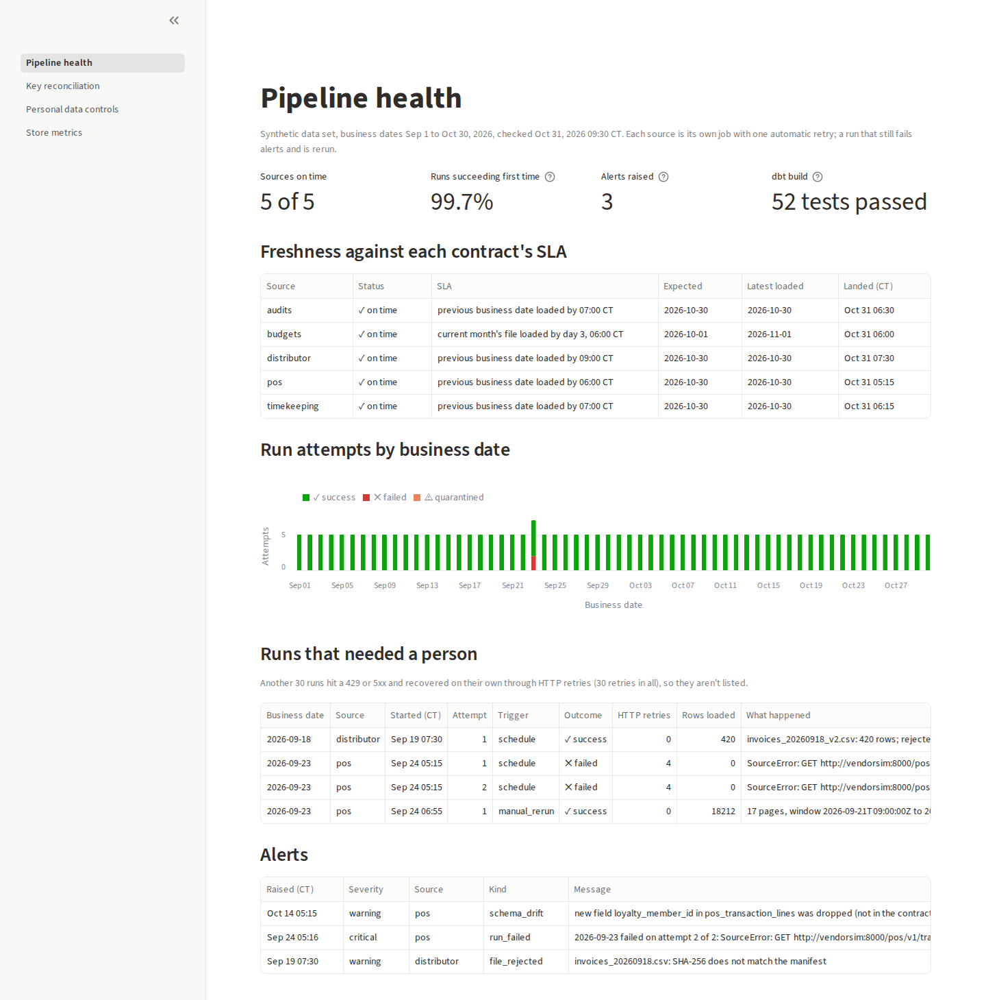
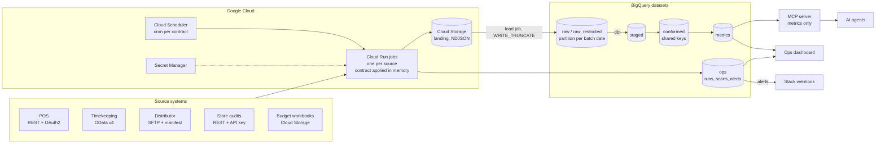

# store-ops-bigquery-pipelines

Governed ingestion of five store systems into a layered BigQuery warehouse that AI agents read through MCP. Python
connectors pull a cloud POS (REST with OAuth2), a workforce management system (OData v4), a distributor's nightly
SFTP drop, a store audit app (REST with an API key) and finance's budget workbooks (a Cloud Storage bucket). A field
contract per source decides, before anything is written, which fields are kept, hashed, masked, restricted or
dropped. Each run lands one file in Cloud Storage and replaces one partition, so reruns never duplicate. dbt builds
staged, conformed and metrics layers on shared store, date, item and employee keys, and a daily reconciliation proves
the POS and labor systems agree on store and business date. An operations dashboard shows freshness, runs, the
reconciliation and the personal-data controls.

This is a reference implementation of the architecture behind a platform I built for a regional convenience store
chain with about 120 stores. The production build is under NDA, so a few integrations are abstracted behind
adapters: BigQuery runs as a Postgres stand-in locally and in CI, Cloud Storage as fake-gcs-server, Secret Manager
as a volume of generated files, and the five source systems as a simulator. It runs on synthetic data, and every
company, place, person, phone number and figure in it is made up.

[](https://github.com/AlexKurinets/store-ops-bigquery-pipelines/actions/workflows/ci.yml)



## Architecture



Locally, `docker compose up` runs all of it: the simulated sources (`vendorsim`), fake-gcs-server, Postgres in place
of BigQuery, a one-shot `pipeline` job that loads the synthetic data set the way the scheduled jobs would, the MCP
server and the dashboard.

## What the synthetic data contains

20 stores in three states and two time zones (two of them open 24 hours), 27 items including fuel, and business dates
2026-09-01 to 2026-10-30. The seed job moves the simulator's clock through 60 mornings and runs each source at its
Cloud Scheduler time, so the run history looks like production's. The sources carry problems on purpose:

| Planted problem | Where | What the pipeline does |
|---|---|---|
| POS outage, 04:00 to 06:00 CT on Sep 24 | `vendorsim/app.py` | Both attempts fail and alert; the on-call rerun at 06:55 loads the day |
| 429s with Retry-After, 503s, tokens expiring every 25 calls | `vendorsim/app.py` | Backoff honors Retry-After; a 401 refreshes the token and repeats the same cursor |
| Offline terminals uploading 26 hours late (two store-days) | `vendorsim/data.py` | The three-day lookback picks them up; the reconciliation explains the gap |
| A large order voided the morning after | `vendorsim/data.py` | Latest version wins in staged; explained in the reconciliation |
| A store renumbered after a remodel | `transform/seeds/store_xref.csv` | Crosswalk rows with validity dates keep one `store_key` |
| SSNs in the timekeeping notes field, PII in audit comments, card numbers | `vendorsim/data.py` | Notes never requested; comments masked; the post-load scan finds nothing |
| A new POS field (`loyalty_member_id`) from Oct 14 | `vendorsim/data.py` | Dropped by default-deny, alerted once as schema drift |
| A truncated distributor file, resent as `_v2` | `vendorsim/data.py` | Rejected on SHA-256, alerted; the resend loads |
| Finance re-uploads October's budget to fix a typo | `vendorsim/data.py` | The new object generation becomes budget version 2 |
| A day the timekeeping system never imported sales; a hand-edited figure | `vendorsim/data.py` | `missing_in_labor_system` and `unexplained` in the reconciliation |
| An audit site for a store that hasn't opened | `vendorsim/data.py` | Held in `conformed.unmapped_keys`, not dropped |

## Design decisions

**Contracts deny by default, and they are applied before anything is written.** Every source has a YAML contract
(`contracts/`) listing each field with a class: `keep`, `hash` (HMAC-SHA256 with one key from Secret Manager, so the
POS operator ID and the timekeeping employee ID still join), `mask` (free text with SSNs, card numbers, emails and
phone numbers replaced), `restrict` (written only to `raw_restricted`) or `drop`. A field the contract doesn't list is
dropped and raised as schema drift (`src/storeops/contracts.py`). For OData the contract becomes the `$select`, so
SSNs and names are never requested (`connectors/timekeeping.py`).

**A second, independent check after the load.** The runner reads back every text column of the new partition and
looks for SSN-shaped values and Luhn-valid card numbers (`runner.py`, `pii.py`). A hit deletes the partition, marks
the run quarantined and alerts. A full sweep of every non-restricted dataset runs after the dbt build and in CI. The
card pattern requires real card shapes standing alone; a looser one flagged POS transaction IDs like
`0101-20260901-0001`, about one in ten of which pass Luhn by chance.

**Land a file, then replace a partition.** Each run writes one gzipped NDJSON object per table to Cloud Storage and
loads it into the `table$YYYYMMDD` partition with `WRITE_TRUNCATE` (`warehouse/bigquery.py`). Rerunning a day
replaces it. Streaming inserts were the first approach in production and were dropped after a retried page produced
duplicates. Row counts are checked from extract to file to partition, and a mismatch fails the run.

**The business date belongs to the store.** POS sends UTC timestamps. The business date is local time minus the
store's day-start hour (04:00), so a 01:30 sale counts toward the evening before (`transform/macros/dialect.sql`).
Bucketing by calendar date instead is what the reconciliation caught first in production.

**Reconcile totals, not just presence.** A check that both systems have a row for each store-day passes even when
the date rule is wrong. `metrics.key_reconciliation_daily` compares POS sales with the sales the timekeeping system
imports from the POS at 05:00, within 0.5%. For a mismatch it recomputes POS as of that import time, which tells a
late ticket or a void apart from a real disagreement, and anything left over is marked `unexplained` rather than
given a guessed reason.

**Crosswalks with validity dates.** `store_xref` has a row per system code and the dates it was valid, plus aliases
for the names finance types into budget sheets. Codes that don't map land in `conformed.unmapped_keys`. A dbt test
fails the build if any budget row doesn't map, because fuzzy name matching once paired two different stores.

**Agents read documented tables, through a role that can't see anything else.** dbt persists model and column
descriptions into the warehouse (`persist_docs`), and the MCP server (`mcp_server.py`) serves them with the data: list
tables, describe one, query rows with store and date filters and a 500-row cap, and check freshness. It connects as
`agent_reader`, which can read the `metrics` dataset and nothing else. There is no free-form SQL tool.

**SQL written once for two engines.** The few places BigQuery and Postgres differ (time zones, date spines, regex,
week starts) are dispatch macros in `transform/macros/dialect.sql`. Incremental models replace whole business dates:
`insert_overwrite` on BigQuery partitions, `delete+insert` keyed on the date in Postgres.

**No credentials in the repository.** On first start the `secrets` service generates random values into a volume
that stands in for Secret Manager; the simulator, Postgres and the pipeline read from it. In production
`STOREOPS_SECRETS=gcp:<project>` reads Secret Manager. CI runs gitleaks over the full history.

## Running it

```
docker compose up -d --build --wait --wait-timeout 1200
```

The first start builds the image and runs the seed job, about seven minutes on a laptop. Host ports default to 5532
(Postgres), 8250 (simulator), 8251 (MCP) and 8560 (dashboard); override them with `POSTGRES_PORT`, `VENDORSIM_PORT`,
`MCP_PORT` and `DASHBOARD_PORT`. The data set is evaluated at 2026-10-31 09:30 CT (`STOREOPS_NOW`), so freshness is
judged as of that morning.

The dashboard is at http://localhost:8560. The MCP server speaks streamable HTTP at http://localhost:8251/mcp.

Checks and a rerun, the commands the runbook uses:

```
docker compose run --rm pipeline storeops check freshness
docker compose run --rm pipeline storeops check pii
docker compose run --rm pipeline storeops check reconciliation
docker compose run --rm pipeline storeops run pos --date 2026-10-30
docker compose run --rm pipeline storeops contracts
```

Alerts posted to the Slack-style webhook are at http://localhost:8250/hooks/slack.

## Tests

```
pip install -e ".[dev]"
pytest
```

Unit tests cover the contracts, the PII patterns, the connectors against the simulator (paging, token refresh,
Retry-After, `$select`, manifest checks, budget generations), the schedules and the BigQuery adapter against a fake
client. With `TEST_DATABASE_URL` set to a Postgres superuser connection, the warehouse tests create a throwaway
database with the stack's roles, load the full synthetic data set through the pipeline, run dbt (seeds, 30 models,
52 data tests) and check the reconciliation, the access grants, quarantine on a contract mistake, idempotent reruns,
the MCP tools and every dashboard page. CI also runs Terraform validate, gitleaks and `scripts/smoke.sh`, which
brings the Compose stack up from nothing and runs every command block in this README.

## Deploying to Google Cloud

`deploy/gcp` is a Terraform module: the BigQuery datasets with their IAM (agents read `metrics` only; a finance group
reads the restricted datasets), the landing buckets, Secret Manager secrets, a Cloud Run job per contract with one
task retry, Cloud Scheduler triggers whose cron and time zone come from the same contract files, the dbt job, and the
MCP server as an internal Cloud Run service. CI runs `terraform validate` on it; it has not been applied to a real
project from this repository. The production dbt target is in `transform/profiles.yml`.

## Layout

```
contracts/            one YAML per source: fields and classes, schedule, freshness SLA
src/storeops/         connectors, contracts, runner, warehouse adapters, checks, MCP server, CLI
src/vendorsim/        the simulated source systems and synthetic data (not part of the pipeline)
transform/            dbt project: seeds, staged, conformed, restricted and metrics models, tests
dashboard/            Streamlit operations dashboard
deploy/gcp/           Terraform for BigQuery, Cloud Storage, Secret Manager, Cloud Run and Scheduler
db/init/              datasets and reader roles for the Postgres stand-in
docs/                 runbook, freshness SLAs (generated), screenshots
scripts/smoke.sh      the README, run end to end
```

## What is deliberately left out

Real vendor APIs and credentials. BigQuery column-level policy tags (the restricted datasets carry dataset-level IAM
instead). Cloud Monitoring alert policies on job failures; the runner posts its own alerts. A log-based audit of who
queried the restricted datasets. The agents themselves: this repository stops at the tables and the MCP server they
read.

## License

MIT, Alex Kurinets
